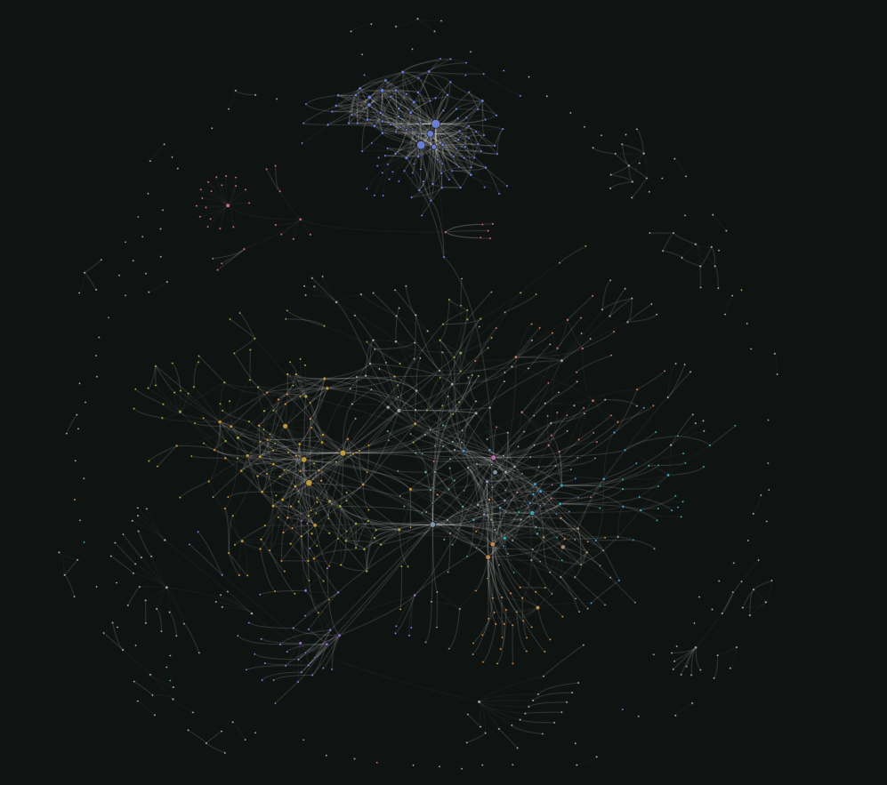
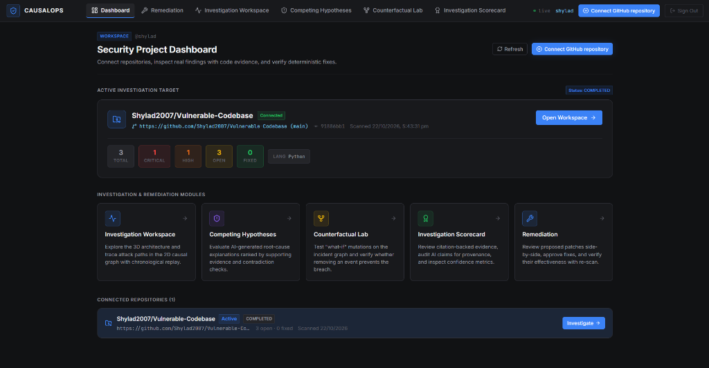
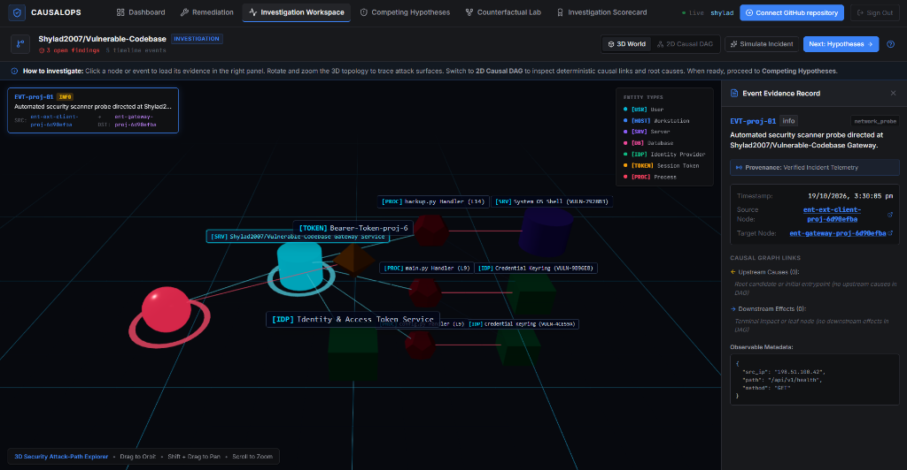
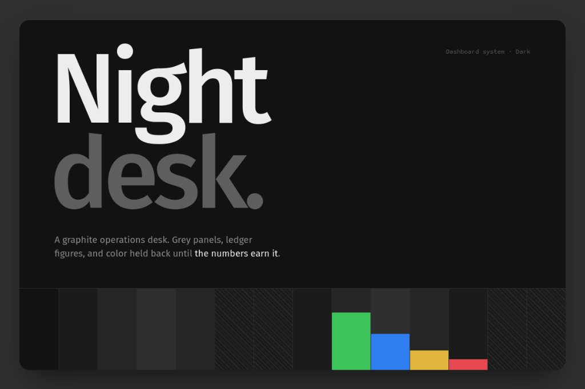
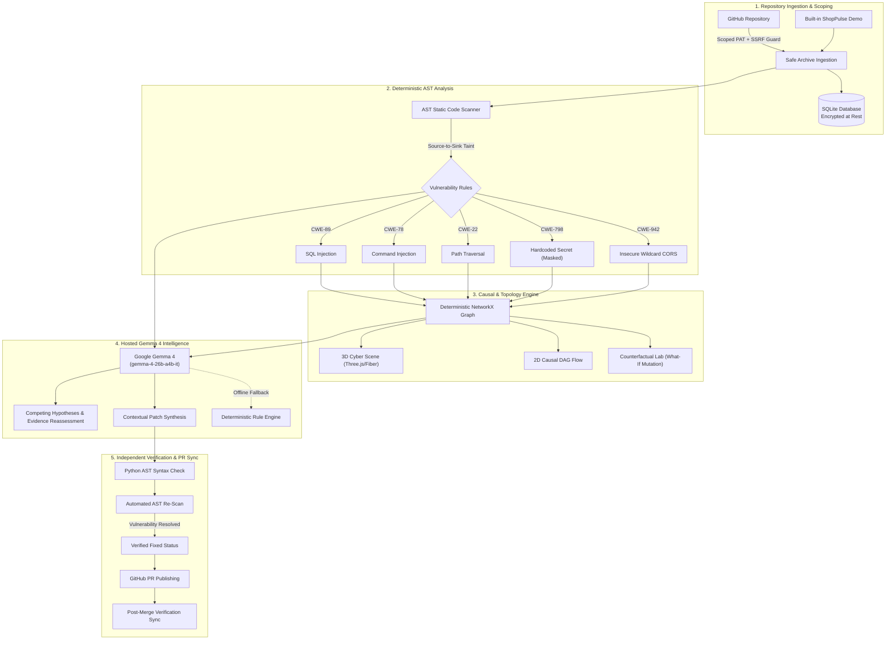

# CausalOps

<p align="center">
  <strong>Build with AI. Secure with confidence.</strong><br>
  <em>AI proposes. Source evidence explains. Independent checks verify.</em>
</p>

<p align="center">
  
  
  
  
  
  
  
  
</p>

---

## Codebase Architecture & Structural Topology

The following graph visualization was extracted using Graphify to map the module dependencies, causal relationships, and structural interconnectivity across the CausalOps backend and frontend engines:

<p align="center">
  
  <br>
  <em>Figure 1: Full-system structural topology graph extracted with Graphify, visualizing cross-layer dependencies between AST analyzers, causal engines, Gemma 4 endpoints, and the React Three Fiber cyber world.</em>
</p>

---

## Overview

**CausalOps** is an AI-assisted application-security and causal intelligence platform designed to bridge the gap between static vulnerability detection, root-cause investigation, and verifiable remediation.

Instead of presenting developers with endless walls of disconnected static warnings or unverified AI code suggestions, CausalOps operates on a foundational engineering principle:

> **AI proposes. Source evidence explains. Independent checks verify.**

CausalOps connects directly to your source-code repository, analyzes AST data-flow paths to uncover high-impact security vulnerabilities, reconstructs attack paths in interactive 3D and 2D causal DAGs, generates evidence-grounded hypotheses with **Google Gemma 4**, synthesizes contextual patches, and **independently verifies** that fixes eliminate the security flaw without breaking syntax or introducing regressions.

---

## The Problem & The Solution

| The Challenge in Modern AppSec | The CausalOps Solution |
| :--- | :--- |
| **Alert Fatigue & Noise:** Static analysis tools generate hundreds of low-signal alerts without contextual evidence or causal links. | **Deterministic AST Data Flow:** Traces exact source-to-sink taint paths (CWE-89, CWE-78, CWE-22, CWE-798, CWE-942) with line-level code evidence and automated secret masking. |
| **Disjointed Attack Context:** Developers cannot visualize how an entry point connects to sensitive data sinks or lateral processes. | **Interactive 3D/2D Causal Explorer:** Visualizes network zones, server nodes, identities, and processes in a 3D topology with chronological event replay and a 2D DAG. |
| **Unreliable "Black Box" AI Suggestions:** Generic LLM-generated code patches frequently hallucinate APIs, break syntax, or fail to resolve the underlying bug. | **Gemma 4 with Independent Verification:** Google Gemma 4 (`gemma-4-26b-a4b-it`) synthesizes context-aware patches with unified diffs. CausalOps compiles, re-scans AST, and tests the patch before recommending approval. |
| **Untested Remediation Outcomes:** Security teams deploy fixes without knowing whether the full attack chain has been severed. | **Counterfactual Investigation Lab:** Allows investigators to perform "what-if" mutations, sever incident nodes, and recompute graph downstream impact deterministically. |

---

## Application Gallery

<p align="center">
  
  <br>
  <em>Figure 2: Security Project Dashboard displaying active repository status, severity breakdown, and quick access to investigation and remediation modules.</em>
</p>

<p align="center">
  
  <br>
  <em>Figure 3: Interactive 3D Cyber Topology with live node inspection, causal graph link tracking, and line-level event evidence records.</em>
</p>

<p align="center">
  
  <br>
  <em>Figure 4: Public landing page built on the Nightdesk graphite design system, communicating the core 3-step value proposition and instant demo mode.</em>
</p>

---

## System Architecture



---

## Key Features

### 1. Secure Single-Repository GitHub Integration
- Connects to one user-selected repository at a time with strict token-scoping checks.
- Encrypts access tokens at rest using **Fernet symmetric cryptography**.
- Implements comprehensive **SSRF protection** validating repository URLs against private, internal, or loopback network addresses.
- Resolves and pins exact commit SHAs to guarantee idempotent scans.

### 2. Deterministic AST Code Scanner
- Uses Python's native `ast` parser to trace real source code sinks and tainted inputs without code execution.
- Automatically redacts and masks sensitive keys and JWT tokens in findings to prevent credential exposure.
- Computes genuine line ranges, CWE IDs, severity scores, and file locations.

### 3. Interactive 3D Cyber World & 2D Causal DAG
- Rendered with **React Three Fiber** and **Three.js** in the graphite **Nightdesk** operations desk theme.
- Visualizes security zones (`EXTERNAL`, `DMZ`, `PROD_INTERNAL`, `IDENTITY`), servers, databases, and processes with real-time hover states and camera orbit controls.
- Synchronized with a 2D directed acyclic graph (DAG) tracing upstream causes and downstream impacts.

### 4. Hosted Google Gemma 4 Integration
- Calls Google's hosted **`gemma-4-26b-a4b-it`** model via the official `google-genai` SDK.
- Configured with resilient **45-second deadlines** and token-budget constraints to prevent premature timeouts during complex JSON patch synthesis.
- Evaluates **Competing Hypotheses** grounded strictly in recorded telemetry event IDs with support for investigator challenges.
- Transparent provenance tracking (`source="gemma-4-26b-a4b-it"` vs. `source="deterministic_fallback"`).

### 5. Counterfactual Investigation Lab
- Formulates "what-if" hypotheses by mutating or severing events on an isolated copy of the incident scenario.
- Re-executes the deterministic graph engine to measure exact edge severance, verifying whether breaking a link neutralizes an attack path.

### 6. Evidence Audit & Reliability Scorecard
- Mathematically scores AI findings against citation validity, unsupported claim detection, uncertainty calibration, and ground-truth benchmark isolation.

### 7. Independent Fix Verification & GitHub PR Workflow
- Automatically parses proposed remediation code using AST to verify syntax validity before applying.
- Re-scans the patched file to prove that the targeted vulnerability is severed while leaving unrelated source code intact.
- Publishes approved fixes to a new Git branch and creates a pull request on GitHub without touching protected default branches.
- Monitors merge status and updates project findings to `VERIFIED_FIXED` upon post-merge sync.

---

## Tech Stack

| Domain | Technologies |
| :--- | :--- |
| **Frontend** | React 19, Vite 8, Tailwind CSS v4, Three.js, React Three Fiber (`@react-three/fiber`), Drei (`@react-three/drei`), Zustand, Lucide React |
| **Backend** | Python 3.14+, FastAPI, Pydantic v2, SQLite3, NetworkX, Uvicorn, Cryptography (Fernet), HTTPX |
| **AI / Inference** | Google Gemma 4 (`gemma-4-26b-a4b-it`) via Google GenAI SDK with deterministic fallback |
| **Design System** | Nightdesk (graphite operations desk theme, monospace typography, high-contrast badges) |
| **Testing** | Pytest (backend), Vitest & React Testing Library (frontend) |

---

## Project Structure

```
CausalOps/
├── backend/
│   ├── app/
│   │   ├── ai/            # Google Gemma 4 service client, timeouts & fallbacks
│   │   ├── analysis/      # AST code scanner, vulnerability rules, GitHub ingest
│   │   ├── api/           # FastAPI routers (auth, codebase, github_auth, scenarios)
│   │   ├── audit/         # Scorecard evaluation & ground-truth audit engine
│   │   ├── auth/          # PBKDF2 hashing, session tokens, project authorization
│   │   ├── db/            # SQLite database manager & automated migrations
│   │   ├── engine/        # NetworkX attack graph builder & counterfactual engine
│   │   ├── models/        # Pydantic schemas (findings, events, patches, graphs)
│   │   └── services/      # Project storage, Fernet credential encryption, GitHub PRs
│   ├── data/
│   │   └── projects/      # Canonical built-in demo project (ShopPulse API)
│   ├── tests/             # 16 Pytest test modules (91 tests)
│   ├── main.py            # FastAPI application entrypoint
│   └── requirements.txt
├── frontend/
│   ├── src/
│   │   ├── api/           # Backend HTTP client
│   │   ├── components/    # 3D Cyber Scene, 2D DAG, FixesView, HypothesesView
│   │   ├── store/         # Zustand global state (investigationStore, authStore)
│   │   └── test/          # 11 Vitest test suites (40 tests)
│   ├── package.json
│   └── vite.config.js
├── docs/
│   ├── assets/            # Graphify architecture graph & application screenshots
│   ├── API_CONTRACT.md    # Complete OpenAPI contract & endpoint specifications
│   ├── ARCHITECTURE.md    # Architectural invariants & security boundaries
│   ├── DECISIONS.md       # ADRs on causal modeling, R3F, and Gemma inference
│   └── PROJECT_SPEC.md    # Product specifications & vulnerability taxonomy
├── test-fixtures/         # Synthetic vulnerable lab ZIP & source files
├── scripts/               # GitHub PR helper, repository validation & search tools
├── adapters/              # AI assistant integration guides (Claude, Gemini, GPT)
├── .gitignore
├── pytest.ini
└── README.md
```

---

## Getting Started

### Prerequisites
- **Node.js** >= 18 (Tested on v24)
- **Python** >= 3.10 (Tested on Python 3.14.3)
- **Git**

---

### 1. Backend Setup

```bash
# Navigate to the backend directory
cd backend

# Create and activate virtual environment
python -m venv venv

# Windows PowerShell
.\venv\Scripts\activate
# macOS / Linux
# source venv/bin/activate

# Install dependencies
pip install -r requirements.txt

# Configure environment variables
cp .env.example .env
```

Open `backend/.env` and supply your credentials:
```env
GEMMA_API_KEY=your_google_ai_studio_api_key
GEMMA_MODEL_NAME=gemma-4-26b-a4b-it
GEMMA_TIMEOUT_MS=45000
CREDENTIAL_ENCRYPTION_KEY=
```
*(Note: If `GEMMA_API_KEY` is not provided, CausalOps automatically engages its built-in deterministic fallback engine for all remediation and hypothesis workflows).*

Start the backend server:
```bash
uvicorn main:app --reload --port 8000
```
The API documentation is interactively available at `http://localhost:8000/docs`.

---

### 2. Frontend Setup

In a separate terminal:

```bash
# Navigate to the frontend directory
cd frontend

# Install dependencies
npm install

# Start the Vite development server
npm run dev
```

Open **`http://localhost:5173`** in your browser.

> **Tip:** You can immediately explore CausalOps without entering credentials by clicking **"Load Demo Project"** (ShopPulse e-commerce API) or logging in with pre-configured analyst test credentials.

---

## Running Tests

Both backend and frontend test suites are thoroughly instrumented with hermetic mocks and regression guards:

### Backend Test Suite (Pytest — 91 Tests)

```bash
# From the repository root
.\backend\venv\Scripts\pytest.exe backend/tests -v
```

```text
======================= 91 passed in 459.89s =======================
```

### Frontend Test Suite (Vitest — 40 Tests)

```bash
# From the frontend directory
cd frontend
npx vitest run
```

```text
Test Files  11 passed (11)
     Tests  40 passed (40)
  Duration  26.83s
```

### Production Build Verification

```bash
# Compile and optimize production bundles
cd frontend
npm run build
```

```text
✓ 2504 modules transformed.
✓ built in 1.07s
```

---

## Security & Privacy Invariants

1. **Zero Secret Persistence in Source:** `.env` files, actual PAT credentials, and private keys are strictly excluded from source control.
2. **Encrypted at Rest:** All GitHub repository access tokens stored in SQLite are encrypted with **Fernet (AES-128-CBC + HMAC-SHA256)**.
3. **No Code Execution During Scanning:** AST parsing inspects code structure statically without executing untrusted scripts.
4. **Independent Fix Verification:** AI-suggested code fixes must pass static syntax validation and AST re-scanning before being accepted.
5. **No Hallucinated Causal Links:** Causal graph relationships require verifiable telemetry citations; unevidenced AI claims are flagged in the Investigation Scorecard.

---

## License

This project is licensed under the [MIT License](LICENSE).
