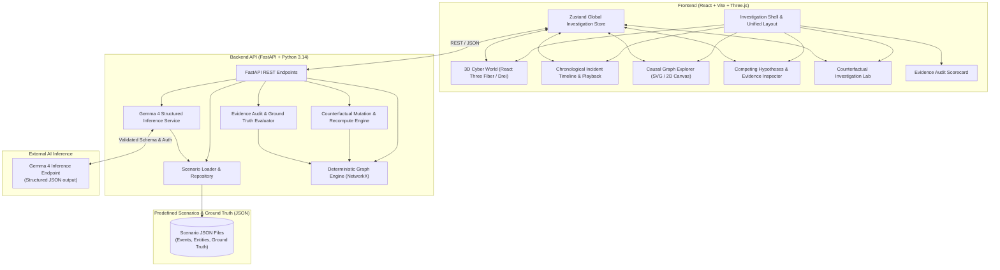

# CausalOps — System Architecture

---

## Architectural Principles & Boundaries

1. **Separation of Concerns**:
   - The **Deterministic Graph Engine** computes graph topologies and edge provenance. The AI model is strictly prohibited from inventing graph nodes or edges.
   - The **AI Service (Gemma 4)** generates, evaluates, and challenges hypotheses grounded *only* on actual event IDs supplied in the prompt context.
   - The **Evidence Audit Service** validates that all AI citations reference existing events and flags ungrounded claims.
   - The **Frontend** presents visual representations and provides smooth user interaction without duplicating backend domain logic.

2. **Deterministic Reproducibility**:
   - Given the identical scenario JSON, the deterministic graph builder and counterfactual diffing algorithms produce identical outputs byte-for-byte.

3. **Safe Counterfactual Branching**:
   - Baseline scenario states are treated as read-only.
   - Experiments create isolated in-memory mutations (`ScenarioMutation`), run the deterministic engine, calculate the symmetric difference ($\Delta$), and return the comparative analysis.

4. **Security & Secrets**:
   - AI credentials (Google AI Studio / Gemma API keys) reside strictly on the backend.
   - No secret keys are ever transmitted to the frontend or checked into version control.

5. **Evaluation & Audit Scorecard Engine (Phase 7)**:
   - Evaluates investigative outputs across 9 distinct metric dimensions with explicit provenance:
     - `citation_validity_ratio` (Deterministic): Mathematical check that all cited event references exist.
     - `evidence_support_ratio` (Deterministic): Verifies topological connectivity and observable data.
     - `unsupported_claim_count` (Rule-Based): Flags hypotheses asserted without supporting telemetry.
     - `critical_milestone_coverage` (Deterministic): Quantifies coverage of primary attack milestones.
     - `contradiction_awareness_score` (Rule-Based): Measures active falsification and counter-evidence testing.
     - `uncertainty_calibration_score` (Rule-Based): Penalizes unjustified certainty and rewards assumption disclosure.
     - `counterfactual_consistency_score` (Deterministic): Validates alignment between computed diffs and AI conclusions.
     - `ground_truth_alignment_score` (Isolated Benchmark): Independent benchmark measuring root cause and path recall.
     - `reproducibility_score` (Deterministic): Verifies pure function execution without stochastic drift.
   - Ground truth benchmark is strictly isolated from model prompt contexts to prevent benchmark leakage.

